# Stone Shelter Assistant — An Agentic Search Experiment

Explore the data, try different approaches, or use the domain for your own learning experiments.

Serious engineering questions. Less serious residents.

---

**I put the dataset, search workflow, validation rules, and evaluation tooling together so experiments can focus on agent behavior rather than setup.**

The domain is a shelter for pet stones.

The assistant works with four sources:

- **Stone profiles** (individual preferences and triggers, such as Madame Obsidian’s fear of vacuum cleaners).
- **Staff notes** (observed behavior and history, such as Svetlana singing loudly at 05:00 and two complaints from her neighbors).
- **Stone encyclopedia** (general facts and care advice for each stone type; these do not prove how an individual behaves).
- **Pair compatibility guide** (rules and conditions for two stone types living together).

These sources can disagree, and “a good match” depends on the adopter. Svetlana’s morning concerts are charming—unless you asked for a quiet home.

The repository includes hybrid search, source and quote validation, scenario tests, experiment replay, and tracing.

- **Agent Orchestration:** combined LLM reasoning with deterministic business rules and tool execution.
- **Hybrid Search & RAG:** combined keyword and vector search with Typesense and Qdrant.
- **Evidence & Guardrails:** validated quotes and sources across conflicting data.
- **LLM Evaluation:** built scenario tests, experiment replay, and LLM-as-judge calibration.
- **Observability:** traced model calls, retrieval, and decisions with Langfuse.
- **Backend:** Python, FastAPI, LangGraph, LangChain, Pydantic, SQLAlchemy, PostgreSQL, Typesense, Qdrant, Docker, pytest, Testcontainers, Langfuse, DeepEval, RAGAS.

```mermaid
flowchart TD
    request([POST /api/v1/questions]) --> catalog[Load one English semantic catalog snapshot]
    catalog --> parse[LLM: parse typed goals, criteria, queries and filters]
    parse --> grounding[Grounding: validate question fragments and parsed atoms]
    grounding --> audit[When required, LLM: verify proposals and audit question coverage]
    audit --> resolve[Python: validate audit and resolve typed request]
    resolve --> plan[Python: derive, order and validate permitted tools]
    plan -->|Candidate search only| target{Named recommendation target?}
    plan -->|Reference goals or named recommendation| facts[Execute dependent reference reads in fixed order]
    plan -->|Invalid, unresolved or no permitted tools| clarify[Clarify request]
    facts --> referenceEvidence[LLM: extract reference quotes when sources exist]
    referenceEvidence --> referenceCheck[Python: verify exact quotes, source IDs and scopes]
    referenceCheck --> reference[Optional LLM cited sections; Python validates and renders facts]
    reference -->|Reference only or recommendation coverage blocked| result([HTTP result + trace_id])
    reference -->|Recommendation and complete question coverage| saved[Preserve reference component]
    saved --> target
    target -->|No| prepared[Prepare one hybrid call]
    target -->|Yes| named[Prepare lexical call using target name]
    prepared --> allowance{Within four-call retrieval allowance?}
    named --> allowance
    allowance -->|No| stop[Stop; preserve completed reference work]
    allowance -->|Yes: general target| hybrid[Hybrid tool: two retrieval calls in parallel]
    allowance -->|Yes: named target| lexical[Typesense lexical tool: one retrieval call]
    hybrid --> ts[Typesense card search]
    hybrid --> q[Query embedding and Qdrant card search]
    ts --> engines{Operational retrieval outcome}
    q --> engines
    engines -->|Both succeed| rrf[Python RRF: deduplicate, score, retain provenance]
    engines -->|One fails: retain successful results, no retry| degraded[Trace degraded retrieval, failed engine and safe reason]
    degraded --> rrf
    engines -->|Both fail| error[Propagate search error]
    rrf -->|Results| select[LLM shortlist; Python keeps retrieved IDs, at most 3]
    rrf -->|No results| empty[Empty shortlist with selection note]
    lexical --> identity{Unique PostgreSQL identity and exact ID retrieved?}
    identity -->|Yes: only this ID is eligible for selection| select
    identity -->|No| empty
    select --> cards[Read PostgreSQL cards]
    empty --> cards
    cards --> verify[Verify current PostgreSQL status]
    verify --> evidenceInputs[Load needed compatibility pairs, encyclopedia and observations]
    evidenceInputs --> extract[When criteria need evidence, LLM: extract candidate findings and quotes]
    extract --> evaluate[Python: validate criterion and quote binding; apply availability and compatibility guards]
    evaluate --> rank[Python: score and order eligible recommendations]
    rank --> explanation[Optional LLM explanations; Python validates allowed evidence IDs]
    explanation --> answer[Python: render decisions or evidence fallback]
    answer --> combine[Combine candidate result with preserved reference component]
    stop --> combine
    combine --> result
    clarify --> result
```

