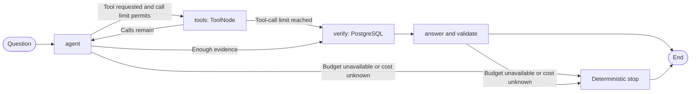

# Фаза 2 ADR

Date: 2026-11-09

Status: Design baseline from the Phase 2 discussion; implementation is pending.

This document consolidates the discussion of the first agent-driven search workflow, mandatory LLM budget reservations, and end-to-end observability. It supplements [Architecture Decisions](adr.md). Implementation progress remains in [Task Log](task-log.md); this document does not mark planned behavior as complete.

## 1. Purpose and starting point

Build one visible, evidence-grounded workflow in the fictional pet-rock shelter. The owner writes application code while learning Python and AI frameworks. Keep components small and inspectable; establish the first working scenario before evaluating retrieval quality or adding production operations.

The handoff baseline is commit `12a9b9d`, with PY-035 completed and 49 tests reported passing. No tests were rerun during the design discussion.

Existing capabilities:

- Registration persists a stone, optional profile, lifetime shelter case, and supplied events in PostgreSQL.
- A stone card and each case event are separate documents in Typesense and Qdrant.
- Lexical and semantic retrieval cover stone cards, event notes, the encyclopedia, and the authored compatibility guide.
- PostgreSQL lookups return current status and shelter, complete case timelines, and stone details by internal or external ID.
- Exact compatibility lookup uses a symmetric `pair_key` in Typesense.
- Assistant tools already use LangChain `@tool` in `assistant/tools.py`.
- `/api/v1/questions` currently returns HTTP 501.
- Local Ollama supplies embeddings. At inspection, `langchain-core` and `langchain-ollama` were installed; LangGraph and an OpenRouter chat adapter were not.

PostgreSQL remains authoritative for operational facts. Search indexes are projections. Current adoption status must never be reconstructed from historical events.

## 2. First end-to-end scenario

> I would like to adopt Madame Obsidian into a quiet home. I already have a granite stone. Would she be a suitable companion, and is she available now?

The supplied Madame Obsidian fixture has a profile describing a quiet, predictable home and an `AVAILABLE` status. It exercises identity retrieval, profile reading, exact pair knowledge, and current availability in one request.

Expected retrieval path:

1. `search_stones_lexical` finds Madame Obsidian by name.
2. `get_stone_details` reads her stone, optional profile, and current case from PostgreSQL.
3. `get_compatibility_pair` retrieves the authored rule for `OBSIDIAN` and `GRANITE`.
4. A mandatory graph step calls `get_current_stone_statuses` immediately before answer generation.
5. The answer explains suitability, relevant care constraints, compatibility, and checked availability with sources.

The model chooses retrieval calls within an allowlist. The expected path is a test scenario, not a hard-coded sequence of model decisions. The first scenario uses lexical search; semantic retrieval can use the existing tools when a later scenario needs description-based matching. Fusion is deferred.

Velvet Slate remains useful for existing lookup and history tests. Its supplied status is `RETURNED`; neither its history nor its quiet-home profile establishes availability.

## 3. Minimal graph



### Agent and tools

Use a typed LangGraph state and the ready-made `ToolNode` to execute existing LangChain tools and return tool results to message history. Use conditional routing with an explicit call counter. For the pilot, allow at most four model-selected tool calls, one per round. Mandatory status verification is separate from this retrieval allowance.

After the final permitted tool result, proceed directly to verification and answer generation. Do not make another retrieval decision call. All model calls, including decisions that produce no tool call, are subject to budget control.

The initial allowlist needs `search_stones_lexical`, `get_stone_details`, and `get_compatibility_pair`. Other existing tools remain available for later scenarios:

| Purpose | Existing tools |
| --- | --- |
| Stone retrieval | `search_stones_lexical`, `search_stones_semantic` |
| Stone details | `get_stone_details` |
| Current availability | `get_current_stone_statuses` |
| Event-note retrieval | `search_case_events_lexical`, `search_case_events_semantic` |
| Complete case history | `get_case_timeline` |
| Reference retrieval | `search_knowledge_lexical`, `search_knowledge_semantic` |
| Exact type compatibility | `get_compatibility_pair` |

### Mandatory verification

Collect candidate stone IDs from actual tool results. Code invokes `get_current_stone_statuses` for those candidates before generating a recommendation, regardless of whether the model requested that tool. An earlier details lookup does not replace this check.

For the pilot, only a confirmed `AVAILABLE` status permits an adoption recommendation. Missing status does not establish eligibility. A result of `RESERVED`, `ADOPTED`, or `RETURNED` excludes the stone from adoption recommendations. Availability describes the time of the check; this workflow does not reserve or adopt stones.

### Answer and sources

Return a typed result containing answer text, recommended stone IDs, and sources. Preserve provenance:

- Profile and operational details: PostgreSQL record identity and stone ID.
- Compatibility and other indexed knowledge: evidence document ID, title, and `source_key`; retain the source path where available.
- Availability: the PostgreSQL status-check result for the candidate.

Distinguish authored fictional compatibility rules from geological reference information. Do not invent missing profile data or source content. Explain insufficient evidence when a supported answer cannot be formed.

Code validates that recommended IDs belong to checked, eligible candidates and cited IDs belong to evidence actually retrieved. This structural validation does not itself prove the semantic correctness of every sentence; free-form answer evaluation follows the first pilot.

### State and boundaries

State needs message history, a tool-call counter, candidates, evidence, checked statuses, budget state, and correlation identifiers. Begin with a directly callable asynchronous graph. Connect the HTTP endpoint as the next small step. Keep test conversations to at most five turns.

## 4. Generation and embeddings

Use `ChatOpenRouter` from `langchain-openrouter` for generation, with an explicitly configured model supporting tool calling. Bind the existing LangChain tools through the adapter. Retain Ollama for embeddings used by semantic retrieval; embeddings are not generated through the chat model.

Record model identity, generation limits, prompt version, and pricing assumptions for the baseline. Ordinary tests must not call a paid model or depend on the local Ollama service.

## 5. Mandatory budget checks and reservations

The user clarified that reservation means reserving LLM spending capacity. Stone reservation is outside this workflow.

Apply one shared budget-controlled model wrapper to both `agent` and `answer`. Every model invocation must pass through it. The proposed initial scope is a monetary limit per graph invocation.

Track `limit`, `spent`, and `reserved` using `Decimal`. The admission condition is:

```text
spent + reserved + reserve_amount <= limit
```

### Reservation lifecycle

1. Calculate the reservation for the complete input: instructions, history, tool schemas, and tool results, plus the maximum permitted output. Include billable reasoning when applicable. Use the configured model and applicable tariff. A strict monetary ceiling requires a defensible upper bound on call cost; an approximate token count with an arbitrary margin is not a guarantee.
2. Check the balance and increase `reserved` as one operation, before sending the request. Budget admission is controlled by code.
3. On completion, record provider-reported cost and usage, add actual cost to `spent`, remove the corresponding reservation, and release its unused amount. Preserve generation identity for correlation and any later reconciliation.
4. If the budget cannot admit a call, stop with a deterministic message generated by code. The final answer has the same reservation requirement; there is no extra unbudgeted final LLM call.
5. If a request was definitely not sent, release its reservation. If its outcome or charge is unknown, retain the reservation and stop the run. A timeout after sending does not prove that no charge occurred. Release or settle that reservation only after its outcome is established.

Reservations are internal application accounting. OpenRouter performs actual billing. The adapter must expose the cost and usage needed for settlement; verify this when integrating the selected adapter version. Unknown cost must not be silently treated as zero. If an actual charge exceeds the estimate, record the real cost and stop further spending rather than hiding the overrun.

The four-tool limit and the monetary budget are independent controls. Storage and recovery of unresolved reservations across process restarts remain an implementation decision; do not claim a durable cross-run spending guarantee from in-memory state.

## 6. Observability in the first pilot

Include Langfuse from the first working scenario, as selected in the main ADR. Trace the graph, model calls, tool calls, backend requests, budget decisions, status checks, and final validation.

### Identity and propagation

| Identifier | Scope |
| --- | --- |
| `user_id = "local-test-user"` | All requests from the single learning-project user |
| `session_id` | One short conversation containing one or more questions |
| `trace_id` | Complete handling of one question across the application stack |
| `span_id` | One operation within the trace |

A new question gets a new `trace_id`. Questions from the same user share `user_id`; questions in the same conversation also share `session_id`. A user-wide trace would mix separate executions, so user and session attributes provide that grouping.

Create a root trace for direct graph invocation. Once HTTP is connected, start it at the request boundary and return `trace_id` in the response. Propagate the same context through the graph, services, tools, and client operations. Add `trace_id` to structured application logs.

Use the Langfuse LangChain/LangGraph callback for framework operations and explicit nested spans for budget operations and PostgreSQL, Typesense, Qdrant, and Ollama calls. These are client-side spans; visibility into a provider's or database server's internal execution is not implied.

### What to record

- Question, final result, model identity, prompt version, and run configuration.
- Model inputs, available tool schemas, tool results supplied to the model, and returned tool calls.
- Tool name, arguments, tool-call ID, result, duration, and errors.
- Retrieved evidence IDs and provenance; operational lookup identities and checked statuses.
- Graph transitions and their observable causes: tool requested, evidence complete, call limit reached, insufficient budget, mandatory verification, or validation failure.
- Token usage, actual cost, reservation amounts, settlement, and unresolved cost state.
- Final citation and recommendation validation outcomes.

This reconstructs observable decisions and evidence flow. A model-provided short explanation of its selection may be recorded as an explanation, not as a verified transcript of internal reasoning.

Example trace shape:

```text
question
├── agent
│   ├── budget.reserve
│   ├── llm
│   └── budget.settle
├── tool: search_stones_lexical
│   └── typesense.search
├── agent (...)
├── tool: get_stone_details
│   └── postgres.read
├── agent (...)
├── tool: get_compatibility_pair
│   └── typesense.lookup
├── verify
│   └── postgres.current_statuses
└── answer
    ├── budget.reserve
    ├── llm
    ├── budget.settle
    └── validate_sources_and_recommendations
```

Langfuse observes budget decisions; the budget component enforces them. No account-management system is needed for the one test user. Langfuse hosting and exact SDK configuration remain to be selected during implementation.

## 7. Minimal verification

Use existing authored fixtures, a controllable tool-calling model stub, controlled embeddings, and disposable Testcontainers. Populate only the temporary services needed by each scenario. Do not load stones into the persistent local application database for this phase.

| Scenario | Required observation |
| --- | --- |
| Madame Obsidian end to end | Tool calls consume real fixture-backed results; answer references retrieved evidence and a checked available candidate. |
| Stale search status | After indexing, change only test PostgreSQL status to `RESERVED`; mandatory verification excludes the stone even if the model omits a status call. |
| Retrieval call bound | A model stub requesting more tools cannot execute beyond four permitted calls. |
| Insufficient budget | No model invocation occurs without a successful reservation. |
| Settlement | Actual cost updates spending and unused reserved capacity becomes available. |
| Shared invocation budget | Decision calls and final answer generation consume the same run budget. |
| Unknown call outcome | Reservation remains held and further model execution stops. |
| Trace propagation | One question produces a root trace with correctly parented graph, tool, backend, and budget spans. |
| Conversation correlation | A second question has a different trace ID and retains the user and conversation identifiers. |

Use a test span collector for automated tracing checks. Inspect one controlled manual run in Langfuse to confirm the displayed tree. Any real-model smoke run is separate from ordinary tests and must have an explicit budget. Run the relevant existing regression checks when implementation changes land.

These tests establish orchestration, accounting, grounding references, and trace propagation. A scripted model and controlled vectors do not evaluate real model routing, semantic ranking, answer quality, chunking, or embedding quality.

## 8. Delivery boundaries and later work

First deliver the directly callable graph with mandatory budget admission, reservations, status verification, cited results, and tracing. Then expose it through `/api/v1/questions`.

After the first scenario works, add scenarios using semantic search, event notes, timelines, and encyclopedia material as needed. Combine lexical and semantic evidence and evaluate retrieval and answer quality through controlled experiments. Compare models, embeddings, chunks, fusion, and reranking only after establishing a baseline.

Queues, automatic retries, distributed recovery, full CRUD/UI, production deployment, and broad negative-case matrices are deferred. So are stone reservation and adoption writes. Budget uncertainty handling and stale-status verification remain in scope because they enforce explicit pilot requirements.

Before implementation, select the concrete model, tariff source, run budget, output limits, and Langfuse deployment. Verify cost metadata and the reservation upper-bound calculation against that configuration. Assign task IDs through the existing Task Log workflow when implementation scope is selected; this document creates no completed implementation task.

## 9. Reference documentation

Official documentation consulted during the discussion:

- [LangGraph workflows, agents, and ToolNode](https://docs.langchain.com/oss/python/langgraph/workflows-agents)
- [LangChain ChatOpenRouter integration](https://docs.langchain.com/oss/python/integrations/chat/openrouter)
- [OpenRouter tool calling](https://openrouter.ai/docs/guides/features/tool-calling)
- [OpenRouter usage accounting](https://openrouter.ai/docs/cookbook/administration/usage-accounting)
- [Langfuse LangGraph integration](https://langfuse.com/integrations/frameworks/langgraph)
- [Langfuse user tracking](https://langfuse.com/docs/observability/features/users)
- [Langfuse sessions](https://langfuse.com/docs/observability/features/sessions)
