# Current question workflow

```mermaid
flowchart TD
    request([POST /api/v1/questions]) --> catalog[Load one English semantic catalog snapshot]
    catalog --> parse[LLM: parse typed goals, criteria, queries and filters]
    parse --> grounding[Grounding: validate question fragments and parsed atoms]
    grounding --> audit[When required, LLM: verify proposals and audit question coverage]
    audit --> resolve[Python: validate audit and resolve typed request]
    resolve --> plan[Python: derive, order and validate permitted tools]
    plan -->|Candidate search only| target{Named recommendation target?}
    plan -->|Reference goals or named recommendation| facts[Execute dependent reference reads in fixed order]
    plan -->|Invalid, unresolved or no permitted tools| clarify[Clarify request]
    facts --> referenceEvidence[LLM: extract reference quotes when sources exist]
    referenceEvidence --> referenceCheck[Python: verify exact quotes, source IDs and scopes]
    referenceCheck --> reference[Optional LLM cited sections; Python validates and renders facts]
    reference -->|Reference only or recommendation coverage blocked| result([HTTP result + trace_id])
    reference -->|Recommendation and complete question coverage| saved[Preserve reference component]
    saved --> target
    target -->|No| prepared[Prepare one hybrid call]
    target -->|Yes| named[Prepare lexical call using target name]
    prepared --> allowance{Within four-call retrieval allowance?}
    named --> allowance
    allowance -->|No| stop[Stop; preserve completed reference work]
    allowance -->|Yes: general target| hybrid[Hybrid tool: two retrieval calls in parallel]
    allowance -->|Yes: named target| lexical[Typesense lexical tool: one retrieval call]
    hybrid --> ts[Typesense card search]
    hybrid --> q[Query embedding and Qdrant card search]
    ts --> engines{Operational retrieval outcome}
    q --> engines
    engines -->|Both succeed| rrf[Python RRF: deduplicate, score, retain provenance]
    engines -->|One fails: retain successful results, no retry| degraded[Trace degraded retrieval, failed engine and safe reason]
    degraded --> rrf
    engines -->|Both fail| error[Propagate search error]
    rrf -->|Results| select[LLM shortlist; Python keeps retrieved IDs, at most 3]
    rrf -->|No results| empty[Empty shortlist with selection note]
    lexical --> identity{Unique PostgreSQL identity and exact ID retrieved?}
    identity -->|Yes: only this ID is eligible for selection| select
    identity -->|No| empty
    select --> cards[Read PostgreSQL cards]
    empty --> cards
    cards --> verify[Verify current PostgreSQL status]
    verify --> evidenceInputs[Load needed compatibility pairs, encyclopedia and observations]
    evidenceInputs --> extract[When criteria need evidence, LLM: extract candidate findings and quotes]
    extract --> evaluate[Python: validate criterion and quote binding; apply availability and compatibility guards]
    evaluate --> rank[Python: score and order eligible recommendations]
    rank --> explanation[Optional LLM explanations; Python validates allowed evidence IDs]
    explanation --> answer[Python: render decisions or evidence fallback]
    answer --> combine[Combine candidate result with preserved reference component]
    stop --> combine
    combine --> result
    clarify --> result
```

The parser and grounding auditor share the same catalog snapshot. Grounding performs one semantic call when sensitive proposals exist or a recommendation is requested; Python validates its bindings and coverage. Coverage audits exclude malicious meta-instructions while retaining legitimate stone criteria in the same fragment. An unspecified recommendation count uses the configured default; explicit counts remain audited. Unsupported legitimate constraints still block coverage. Recommendation search requires complete question coverage. Independent permitted reference goals can still produce an answer when recommendation coverage is blocked. Tool planning and search orchestration are deterministic Python.

Reference reads cover PostgreSQL name/status resolution, card details and case history, lexical encyclopedia care, exact compatibility pairs and pair lists. They run in dependency order, not in parallel. Named recommendation targets also take this route to resolve their identity before candidate search; the information subject and recommendation target may be different stones. Missing, ambiguous or unretrieved named targets never cause a substitute selection.

General recommendations make one hybrid call. Typesense and Qdrant card retrieval run concurrently, then Python merges their ranks with RRF. If one engine has an operational failure (transport, timeout, server unavailability or rate limit), RRF uses the successful engine results without another retrieval and records degraded retrieval, the failed engine and a safe reason in the trace. Both engine failures remain an error. Invalid backend data, programming errors and cancellation propagate. Hybrid retrieval consumes two of the four allowed candidate backend calls; named lexical search consumes one. There is no model-controlled retrieval loop or retry on an empty shortlist.

After the shortlist, the workflow reads cards and current statuses from PostgreSQL. It loads compatibility pairs when targets require them, encyclopedia entries for character criteria, and observations for character or compatibility evidence. LLM findings retain source and criterion bindings; Python checks verbatim quotations, applies source priority, availability, requirements and compatibility conditions, then calculates the final order. Individual evidence and general type knowledge remain separate. Search rank and event history never override current PostgreSQL availability.

**Graceful degradation (limited scope):** Reference and candidate answers use validated citations and deterministic rendering, with quotes or original evidence as fallbacks when a generated summary or explanation is missing, truncated or rejected by validation. These answer fallbacks do not catch model-call exceptions. Hybrid candidate retrieval alone tolerates one operational engine failure as described above; named lexical and reference lookups keep their existing error behavior. Mixed questions execute reference work first. The final combination preserves both source sets and authoritative statuses, including completed reference work when the candidate branch is empty or stopped at a configured limit. This preservation does not provide recovery from arbitrary exceptions. The combine step represents a shared Python result helper, not another model generation.

Model-stage budget admission wraps parsing, grounding, selection, reference evidence, candidate evaluation and candidate answering; reference summary generation checks admission separately and falls back to facts. A denied wrapped stage stops the workflow and preserves available reference work. Admission is currently a pilot stub that always allows calls, not an enforced spending cap. Tool planning has no model budget admission.

Langfuse retains one trace_id: model calls, engine inputs and durations, RRF ranks/contributions and dropped hits, per-candidate provenance, selected/unselected IDs, verified statuses and final evaluations. Engine/fusion observations reference source texts already recorded in the trace.
