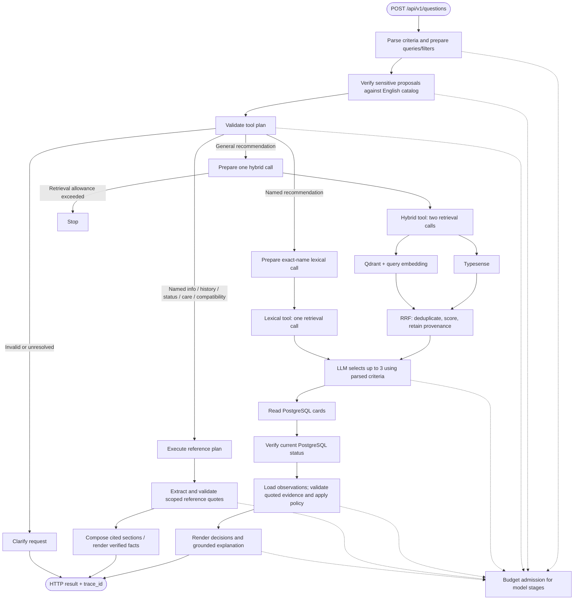

# Current question workflow

General recommendations make one hybrid call, not a model-controlled search loop. Hybrid retrieval consumes two of the four allowed backend calls; named candidate search consumes one. Named status, exact pairs and encyclopedia care keep their reference routes. Search rank never overrides current status or source validation.

Langfuse retains one trace_id: engine inputs and durations, RRF ranks/contributions and dropped hits, per-candidate provenance, selected/unselected IDs, verified statuses and final evaluations. Engine/fusion observations reference source texts already recorded in the trace. Budget admission remains the pilot stub.
